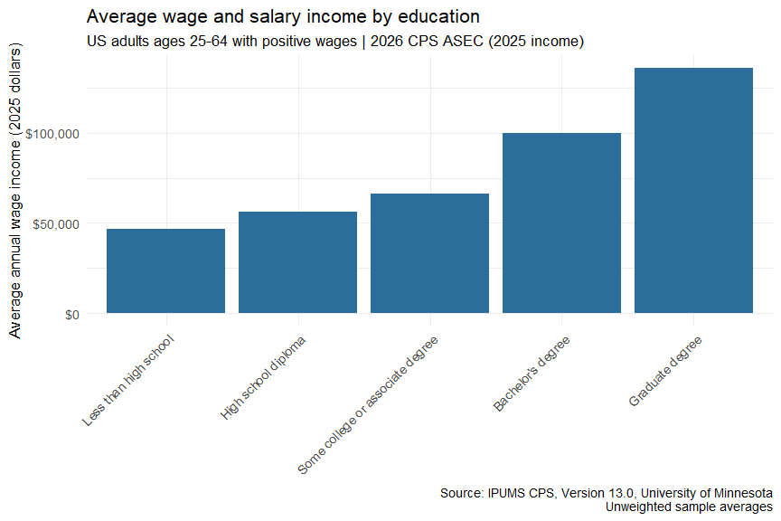

Earnings by Education in the United States
================
Vineeth Thalapaneni
2026-10-28

## Load your IPUMS extract

The extract contains the 2026 Current Population Survey Annual Social
and Economic Supplement (ASEC). Wage and salary income refers to
calendar year 2025. The matching data file and DDI codebook are stored
locally in `data/`.

``` r
ddi <- read_ipums_ddi("data/cps_00001.xml")
cps <- read_ipums_micro(ddi)
```

## Clean and prepare

Keep adults ages 25–64 with positive, valid wage and salary income. The
codebook identifies 99999998 and 99999999 as special income codes, which
are excluded. Education groups use the CPS EDUC codes in this extract’s
codebook: 73 is a high school diploma, 81/91/92 indicate some college or
an associate degree, 111 is a bachelor’s degree, and 123–125 are
graduate degrees. Missing or unclassified education is excluded.

``` r
cps_clean <- cps %>%
  filter(
    AGE >= 25 & AGE <= 64,
    INCWAGE > 0 & INCWAGE < 99999998
  ) %>%
  mutate(
    educ_group = case_when(
      EDUC %in% c(2, 10, 20, 30, 40, 50, 60, 71) ~ "Less than high school",
      EDUC == 73 ~ "High school diploma",
      EDUC %in% c(81, 91, 92) ~ "Some college or associate degree",
      EDUC == 111 ~ "Bachelor's degree",
      EDUC %in% c(123, 124, 125) ~ "Graduate degree"
    ),
    educ_group = factor(educ_group, levels = c(
      "Less than high school", "High school diploma",
      "Some college or associate degree", "Bachelor's degree",
      "Graduate degree"
    ))
  ) %>%
  filter(!is.na(educ_group))
```

## Visualize

Average annual wage and salary income by education group, among adults
with positive wage income. These are unweighted sample averages.

``` r
cps_clean %>%
  group_by(educ_group) %>%
  summarize(avg_wage = mean(INCWAGE)) %>%
  ggplot(aes(x = educ_group, y = avg_wage)) +
  geom_col(fill = "#2C6E9B") +
  scale_y_continuous(labels = dollar_format()) +
  labs(
    title = "Average wage and salary income by education",
    subtitle = "US adults ages 25-64 with positive wages | 2026 CPS ASEC (2025 income)",
    x = NULL,
    y = "Average annual wage income (2025 dollars)",
    caption = "Source: IPUMS CPS, Version 13.0, University of Minnesota\nUnweighted sample averages"
  ) +
  theme_minimal(base_size = 13) +
  theme(
    axis.text.x = element_text(
      angle = 45,
      hjust = 1
    )
  )
```



## Your interpretation

Among adults ages 25–64 with positive wage income in the 2026 CPS ASEC,
average 2025 wage and salary income rises across the education groups,
from about \$46,815 for those with less than a high school education to
about \$135,988 for those with a graduate degree. This is a descriptive
association rather than a causal estimate: differences in work
experience, occupation, and hours worked may also contribute to the
earnings differences.

## Citation (required)

Sarah Flood, Miriam King, Renae Rodgers, Steven Ruggles, J. Robert
Warren, Daniel Backman, Etienne Breton, Grace Cooper, Julia A. Rivera
Drew, Stephanie Richards, David Van Riper, and Kari C.W. Williams. IPUMS
CPS: Version 13.0 \[dataset\]. Minneapolis, MN: IPUMS, 2025.
<https://doi.org/10.18128/D030.V13.0>
